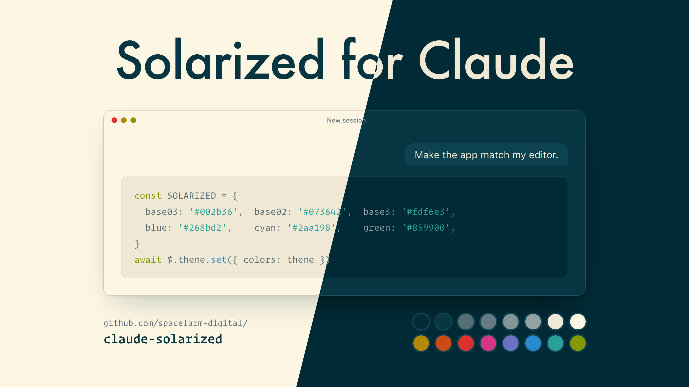

# Solarized for Claude



Solarized Light and Solarized Dark for the Claude desktop and mobile apps, built from
[Ethan Schoonover's Solarized palette](https://ethanschoonover.com/solarized/). One mod carries
both themes. It follows the app's light or dark mode, so there is nothing to switch.

The terminal and editor extensions keep their own colours. Permission prompts always keep the
app's own look.

## Install

Anthropic's plugin directory does not accept themes for now, so Solarized is not listed there and
does not appear in the app's plugin browser on its own. You install it from this repository, which
acts as its own marketplace.

### Desktop app

The desktop app and the `claude` command-line tool read the same settings, so two commands in a
terminal install the theme for the app.

1. Open a terminal and add this repository as a marketplace:

   ```
   claude plugin marketplace add spacefarm-digital/claude-solarized
   ```

2. Install the theme. It goes in at the user scope, so it applies to every project:

   ```
   claude plugin install solarized@claude-solarized
   ```

3. In the desktop app, open the **Code** tab and start a new session. The colours follow the app's
   light or dark mode.

Without the command-line tool, add the marketplace in the app: click **+** next to the prompt box
and select **Add plugins** (or **Plugins**, then **Browse plugins**), choose **Add marketplace**,
enter `spacefarm-digital/claude-solarized`, then install **solarized** for your user account. Where
these controls sit can differ between versions of the app.

### Inside a terminal session

```
/plugin marketplace add spacefarm-digital/claude-solarized
```

```
/plugin install solarized@claude-solarized
```

The terminal itself keeps its own colours. The theme draws in the desktop and mobile apps.

### Turn it off or remove it

In the desktop app, click **+** next to the prompt box and select **Manage plugins**. From a shell:

```
claude plugin uninstall solarized@claude-solarized
```

### Requirements

The desktop app needs Claude Code 2.1.286 or later for mods. Theming is newer than that; this theme
was built with 2.1.325. If the colours do not change, update the app.

## Palette

All 16 Solarized colours are used with their original values.

| Part of the app      | Solarized Light     | Solarized Dark      |
| -------------------- | ------------------- | ------------------- |
| Page                 | `base3` `#fdf6e3`   | `base03` `#002b36`  |
| Cards, panels, menus | `base3` `#fdf6e3`   | `base02` `#073642`  |
| Primary text         | `base02` `#073642`  | `base2` `#eee8d5`   |
| Secondary text       | `base01` `#586e75`  | `base1` `#93a1a1`   |
| Muted text           | `base00` `#657b83`  | `base0` `#839496`   |
| Accent               | `blue` `#268bd2`    | `blue` `#268bd2`    |
| Danger               | `red` `#dc322f`     | `red` `#dc322f`     |
| Success              | `green` `#859900`   | `green` `#859900`   |
| Warning              | `yellow` `#b58900`  | `yellow` `#b58900`  |
| Pro                  | `violet` `#6c71c4`  | `violet` `#6c71c4`  |

Git states use `green` (added), `red` (removed), `yellow` (modified), `violet` (merged),
`magenta` (closed) and `orange` (conflicting). Code blocks ask for the `solarized-light` and
`solarized-dark` highlighting themes.

### Two differences from an editor theme

- **Text is one step stronger.** An editor theme sets comments in `base1` on `base3` (2.5:1) and in
  `base01` on `base03` (2.8:1). The app ignores a whole palette that has text under 3:1, so each
  text tone moves one step along the same scale. Primary text is then 12:1 on the page in both
  modes, and muted text takes the tone an editor theme uses for body text.
- **Role colours keep their hue, not their exact value.** The app's design system derives the
  shades for buttons, badges and borders from each role colour and sets the lightness itself.

## Develop

`hooks/register.ts` holds the palette. `hooks/make-colors.js` comes from Claude Code and is not
edited by hand.

```
claude plugin validate .
claude plugin test .
```

## Licence

[MIT](LICENSE). `hooks/make-colors.js` and `hooks/make-colors.d.ts` are generated by Claude Code
and stay under Anthropic's terms.

## Credit

Solarized was created by [Ethan Schoonover](https://ethanschoonover.com/solarized/) and is
published under the MIT licence at
[altercation/solarized](https://github.com/altercation/solarized). Every colour in this mod is
his. This mod is an independent port and is not affiliated with him or with Anthropic.
